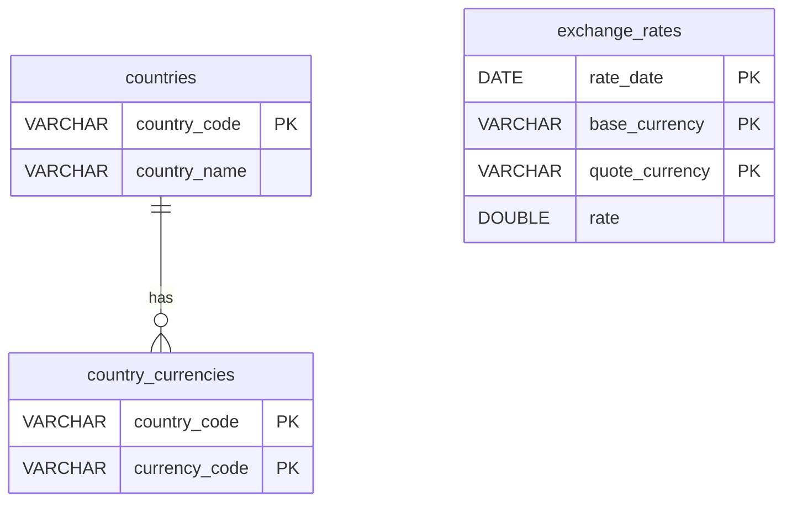
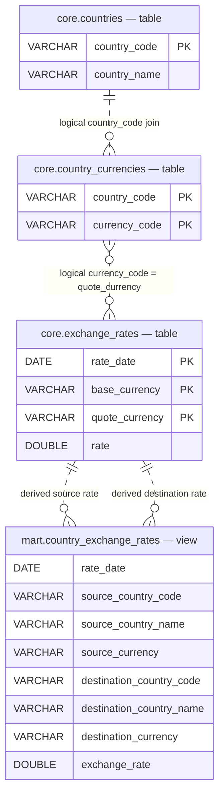

# Part 1: Data Pipeline Implementation

[Project overview and setup](README.md) · [Part 2 placeholder](part2.md)

## 1. Problem Statement

The assignment requires country reference data, USD-based Frankfurter rates from
January 1, 2026, and a DuckDB schema linking the datasets through currency codes.
The outputs must support current and historical country-to-country conversions,
including Peru (PER) to Australia (AUS).

The implementation provides raw ingestion, normalized core tables, a derived
reporting view, a manual daily build, and notebook queries. Historical ingestion is
a separate backfill command. The country source is countries.dev rather than the
REST Countries endpoint named in the assignment; this is a submission deviation,
not a claim that the original endpoint has been implemented.

## 2. Architecture Overview

## Data Model & ERD

The pipeline uses three normalized core tables and one reporting view.



[scripts/build_daily.py](scripts/build_daily.py) coordinates five sequential steps:
country ingestion, rate ingestion, country transformation, rate transformation,
and reporting view creation. Each transformation depends only on its own ingestion;
view creation depends on both transformations. Independent work continues after a
failure. Logging reports step starts, successes, skips, and exception tracebacks.
The process exits `0` on success and `1` on failure, including partial failure.
Individual ingestion/transformation scripts also print progress messages.

There is no automated schedule, orchestration service, or automatic retry mechanism.

## 3. Data Sources

| Source | Implemented endpoint | Requested/consumed fields |
| --- | --- | --- |
| countries.dev | `https://countries.dev/countries` | Requests `name,alpha2Code,alpha3Code,currencies`; models `alpha3Code`, string `name`, and `currencies[].code` |
| Frankfurter | `https://api.frankfurter.dev/v2/rates` | Requests `base=USD` with `date` or `from`/`to`; consumes `date`, `base`, `quote`, `rate` |

**IMPORTANT NOTE:**
* Deviation of source data: 
The assignment specifies `https://restcountries.com/v3.1/all` with fields including
`name`, `cca2`, `cca3`, and `currencies`. 
I realized as I was doing EDA that v1-4 have been deprecated, and v5 is behind a Bearer Token. 
I did start working with the v5 and a dedicated Bearer Token - but on further reflection, did not continue with that. 
Why? 
Because I think the point of the pipeline and the way it's requested is for it to run without any API token and thus, without requiring reviewers to register for or configure API credentials..
As such, I deviated from restcountries and instead, went for open alternatives, finally deciding on countries.dev. Its response has a string name,
`alpha3Code`, and a currency list, rather than the assignment's nested name,
`cca3`, and currency dictionary. 

* Only identification and currency fields needed for conversion are requested. Region, capital, and population are not modeledsince I wanted to go for selective source ingestion.
* The notebook contains earlier experiments and is not the production entry point: I've simply included it to give you an idea of my scratch work.


## 4. Ingestion Strategy

| Raw output | Behavior |
| --- | --- |
| `data/raw/countries/countries_raw.json` | Complete requested country response; latest snapshot replaces the previous file |
| `data/raw/frankfurter/rates_YYYY-MM-DD.json` | One file per actual published date in the response; shared structure for daily/backfill runs |

* The initial backfill calls Frankfurter with `base=USD&from=2026-01-01`; omitted `--end`
defaults to the execution machine's current date. 
* A daily run requests yesterday, using the machine's local calendar date. This reduces the chance of loading a day
whose publications are still in progress, but does not guarantee completeness.
* There is no rolling lookback window or automatic recovery of missed daily runs.
* Returned publication dates can differ from requested dates. * Ingestion does not forward-fill dates or rename records to the requested date, and does not filter returned dates to the requested backfill bounds. 
* Empty rate responses create no files and return normally; this counts as successful ingestion in the daily build.
* A subsequent transformation still processes all existing raw rate files.

[Shared utilities](scripts/ingestion/utils.py) use `requests.get`, raise unsuccessful
HTTP responses, and parse JSON. Countries use a 30-second timeout and rates use
60 seconds. Network, HTTP, parsing, and write errors propagate to the caller.
There are no automatic retries. Country ingestion checks for a nonempty list of
objects; rate ingestion checks for a list and validates publication dates before saving.

JSON is written to a temporary file in the destination directory, then atomically
replaces the target. A failed write preserves the previous target and cleans up the
temporary file. Atomicity applies per file, not across an entire backfill: files
already replaced before a later failure remain replaced. Reruns replace snapshots;
they do not append duplicate raw records or preserve versioned raw history.

## 5. Data Transformation and Modeling

All objects live in `data/warehouse/branch.duckdb`.

| Object | Storage | Grain / enforced primary key |
| --- | --- | --- |
| `core.countries` | Physical table | `country_code` |
| `core.country_currencies` | Physical table | `(country_code, currency_code)` |
| `core.exchange_rates` | Physical table | `(rate_date, base_currency, quote_currency)` |
| `mart.country_exchange_rates` | Derived SQL view | `(rate_date, source_country_code, source_currency, destination_country_code, destination_currency)`; no physical primary key |



The relationships above describe query paths, not enforced foreign keys. In
particular, the many-to-many currency-code relationship is not a unique-key reference.
The two reporting edges represent the two uses of a rate in the derived calculation.

**Countries.** [transform_countries.py](scripts/transformations/transform_countries.py)
trims names, uppercases trimmed codes, and flattens the nested currency list into
distinct pairs. One transaction replaces both country tables. A dictionary keeps
the last usable name for a repeated country code; a set accumulates its currency
relationships across those records. Missing or unusable country identifiers/names
are skipped. A missing currency list is allowed. Empty/all-unusable country input
fails without clearing stored data.

**Rates.** [transform_exchange_rates.py](scripts/transformations/transform_exchange_rates.py)
reads all `rates_*.json` files in sorted filename order, parses record dates and numeric
rates, normalizes codes, and deduplicates at the rate key. The last usable record
wins within the ordered input. Four aligned arrays feed a single parameterized SQL
upsert through `UNNEST`, avoiding row-by-row insert/update calls. Existing keys receive
corrected values; other stored history remains. Types are DATE, VARCHAR, and DOUBLE.
Transactions roll back each transformation's database changes if loading fails.

## 6. Reporting Layer

[mart.country_exchange_rates](scripts/reporting/country_exchange_rates.sql) is defined
by `CREATE OR REPLACE VIEW` after ensuring the `mart` schema exists. It joins countries
to currency mappings, then USD-based observations. The source and destination sets
are joined on the same `rate_date`.

```text
source currency → destination currency
    = destination USD-based rate / source USD-based rate
PEN → AUD = USD-to-AUD / USD-to-PEN
```

Matching publication dates prevents mixing observations from different days. Inner
joins exclude combinations without both observations for that date. Multiple and
shared currencies are retained; same-country and same-currency combinations are also
included. USD itself requires a stored USD-to-USD observation; none is synthesized.

The view reflects committed core-table updates automatically and stores no duplicated
country-pair rate rows. Its definition uses `NOT MATERIALIZED` for the shared query
following a locally observed materialized self-join stall in DuckDB 2.0. The complete
implementation is maintained only in the SQL file linked above.

## 7. Assessment Queries and Results

These results were queried from the local warehouse on **November 3, 2026**. They
are stored reference observations, not live trading rates or guaranteed future outputs.
The local tables contained 250 countries, 268 currency mappings, and 46,789 rate rows.

### “What is the current exchange rate between Peru (PER) and Australia (AUS)?”

Interpret “current” as the latest stored publication date with both PEN and AUD rates:

```sql
SELECT rate_date, source_currency, destination_currency, exchange_rate
FROM mart.country_exchange_rates
WHERE source_country_code = 'PER'
  AND destination_country_code = 'AUS'
  AND source_currency = 'PEN'
  AND destination_currency = 'AUD'
ORDER BY rate_date DESC
LIMIT 1;
```

| Published date | Conversion | Verified exchange rate |
| --- | --- | --- |
| 2026-11-03 | 1 PEN → AUD | 0.41290341220999105 |

### “What was the exchange rate yesterday between Peru (PER) and Australia (AUS)?”

Query yesterday's exact date rather than the previous available observation:

```sql
SELECT rate_date, source_currency, destination_currency, exchange_rate
FROM mart.country_exchange_rates
WHERE source_country_code = 'PER'
  AND destination_country_code = 'AUS'
  AND source_currency = 'PEN'
  AND destination_currency = 'AUD'
  AND rate_date = CURRENT_DATE - 1;
```

| Reference date | Requested publication date | Conversion | Verified exchange rate |
| --- | --- | --- | --- |
| 2026-11-03 | 2026-11-02 | 1 PEN → AUD | 0.41180380935865196 |

The exact-date result was verified using `DATE '2026-11-03' - 1` to make the
reference date explicit. Substitute that expression for `CURRENT_DATE - 1` to
reproduce this dated result. `CURRENT_DATE` follows the database connection's date;
for other time zones or reproducible historical questions, supply an explicit date.
For the yesterday query, an empty result means both observations are not present for
that exact date; it does not silently substitute a rate from another date.

## 8. Data Quality and Edge Cases

Implemented behavior:

- Missing publication dates, including possible weekends/holidays, create gaps.
  Availability varies by currency; the code does not assume every weekend lacks rates.
  Neither transformation nor reporting forward-fills observations. The API may return
  earlier published records for a requested date; ingestion preserves their actual dates.
- Multiple currencies per country and shared currencies survive normalization. Country
  data is the latest snapshot, not historical currency ownership.
- Country/code validation requires nonempty strings; it does not validate length or
  ISO membership. Annotated codes remain. Malformed currency containers can stop a
  country transformation. Rates require a parseable date, USD base, nonempty quote,
  and a finite positive numeric value after conversion. No strict ISO registry or
  original JSON-type validation is applied to numeric values.
- Unusable records are skipped, without rejection counts or a quarantine store.
  Unreadable/malformed JSON or a top-level non-list stops the transformation.
- Duplicate country names use the last usable value; mappings accumulate. Duplicate
  rate keys use the last usable record in sorted-file processing order. Conflicts
  are not flagged separately. Core primary keys and upserts prevent duplicate rows.
- Transactions apply per transformation, not to the whole pipeline. One source can
  commit while another fails. A preexisting reporting view remains and reflects any
  successful core changes even when its recreation step is skipped.
- Empty/all-unusable transformation input fails before modifying the database. A
  successful country snapshot removes prior countries absent from that snapshot.
  Exchange-rate history absent from the current input is retained, not deleted.
- “Latest” is only as fresh as the stored observations. The daily build is not a
  completeness check and does not automatically refresh old dates. DOUBLE calculations
  are approximate and exclude transfer fees and transaction spreads.

Potential improvements, **not implemented**: rejection metrics, strict code validation,
conflict detection, versioned raw snapshots, a bounded historical refresh window,
source-completeness checks, retries/backoff, scheduling, and freshness alerts.

## 9. Running and Validating the Pipeline

Follow [README setup](README.md#setup-and-execution) first. Run commands from the
repository root; both `python -m ...` and direct script execution are supported.

```powershell
# Initial history (end defaults to today), then the complete build.
python -m scripts.ingestion.ingress_exchange_rates backfill --start 2026-01-01
python -m scripts.build_daily

# Refresh a specific published/requested day and reload all existing raw rates.
python -m scripts.ingestion.ingress_exchange_rates daily --date 2026-01-05
python -m scripts.transformations.transform_exchange_rates

# Bounded historical refresh.
python -m scripts.ingestion.ingress_exchange_rates backfill --start 2026-01-01 --end 2026-01-31
python -m scripts.transformations.transform_exchange_rates

# Refresh only countries and their warehouse tables.
python -m scripts.ingestion.ingress_countries
python -m scripts.transformations.transform_countries

# Create/update only the reporting view after the core tables exist.
python -c "from scripts.build_daily import create_reporting_view; create_reporting_view()"
```

The daily command has no backfill/date flags. Ingestion's backfill validates that
start is not after end; default start is January 1, 2026. Transformation CLI entry
points accept no path flags, although their Python functions accept path arguments.
A smaller first run can omit backfill, with correspondingly limited history.

Use [querying_data.ipynb](querying_data.ipynb) with a notebook kernel that has the
project dependencies installed. Notebook tooling is separate from `requirements.txt`.
The following code also works in a Python session started from the repository root:

```python
import duckdb

with duckdb.connect("data/warehouse/branch.duckdb", read_only=True) as con:
    for table in ("core.countries", "core.country_currencies", "core.exchange_rates"):
        print(table, con.execute(f"SELECT count(*) FROM {table}").fetchone()[0])
    result = con.execute("""
        SELECT rate_date, source_currency, destination_currency, exchange_rate
        FROM mart.country_exchange_rates
        WHERE source_country_code = 'PER' AND destination_country_code = 'AUS'
          AND source_currency = 'PEN' AND destination_currency = 'AUD'
        ORDER BY rate_date DESC LIMIT 1
    """).fetchall()
    print(result)
```

Close notebook connections before a build: another process holding the database can
prevent write access. The context manager above closes its connection automatically.
Raw JSON and database/WAL files are generated artifacts ignored by Git; `.gitkeep`
files preserve directories. Python caches are ignored and removed from tracking.

To verify the reporting grain, run this SQL through the same connection:

```sql
SELECT count(*) AS duplicate_grain_groups
FROM (
    SELECT rate_date, source_country_code, source_currency,
           destination_country_code, destination_currency
    FROM mart.country_exchange_rates
    GROUP BY rate_date, source_country_code, source_currency,
             destination_country_code, destination_currency
    HAVING count(*) > 1
);
```

Verified local result on November 3, 2026: **0 duplicate grain groups**. Runtime and
row counts depend on the raw data present. No fresh API ingestion was run for this
documentation update; the reported results come from the existing warehouse.

## 10. Design Decisions and Trade-offs

| Decision | Reason and trade-off |
| --- | --- |
| Local DuckDB warehouse | SQL analytics with minimal setup; shared application serving and concurrent writers would need a different operational design |
| Normalized core tables | Preserves multiple/shared currencies and stores each daily rate once; reporting requires joins |
| Reporting view | Keeps cross-rate logic in one SQL definition without another physical load; country-pair queries expand combinations at query time |
| Raw JSON retained separately | Supports inspection and reprocessing without another API request; snapshots are overwritten rather than versioned |
| Source-specific ingestion plus shared HTTP/write helpers | Reuses transport and persistence while keeping historical retrieval specific to Frankfurter |
| Yesterday as the daily target | Avoids relying on an unfinished current day; latest available data can still be incomplete or lagging |
| Bulk rate upsert | Avoids individual SQL calls per rate; the current script still reads and holds all historical raw records in memory each run |
| Lightweight validation | Keeps this assessment small; strict ISO validation, conflict/rejection reporting, and source-schema evolution remain limitations |

Scheduling, API serving, cloud deployment, retries, monitoring, stronger validation,
and historical mapping validity are future work, not functionality claimed here.
[Part 2](part2.md) is reserved for the separate production-design response.
