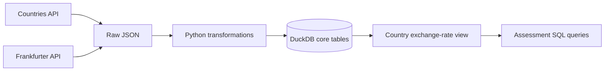
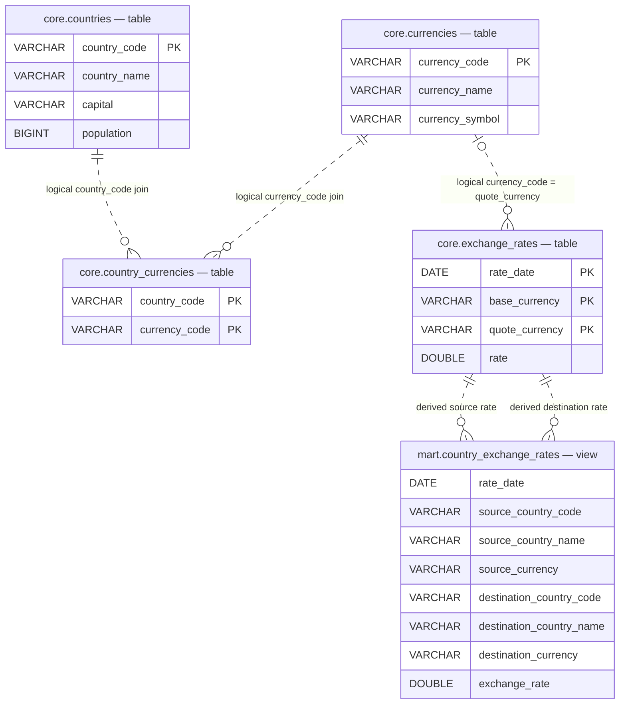

# Part 1 — Country Exchange-Rate Pipeline

[README / setup](README.md) · [Part 2](part2.md)

## 1. Solution Overview

Alright let's get to the meat of it all! 

The assessment asks for country reference data, USD-based Frankfurter exchange rates beginning January 1, 2026, and a DuckDB model that supports current and historical country-to-country currency conversion.

Let's see how I've implemented this.

## 2. Architecture and Data Model

The central design is **four normalized physical tables and one derived reporting view**. The four normalized tables include a bridge model for country-to-currency mappings, specifically to preserve countries with multiple currencies and currencies shared by multiple countries. 

### Pipeline at a glance



* While we have separate scripts for ingestion, transformation and reporting view creation, [scripts/build_daily.py](scripts/build_daily.py) coordinates it all in one script. 
* Each transformation depends on its own ingestion; view creation requires both transformations. Independent steps continue after failures. 
* The script logs outcomes and exits with a nonzero status on failure.
* The daily build is manually executable; automated scheduling and automatic retries are not implemented.

### Entity relationship diagram (ERD)



**How to read the diagram?** 
1. Solid entities labeled `core` are stored tables; `mart.country_exchange_rates` is a calculated SQL view, not a fifth physical table. 
2. Dashed relationships represent **logical joins**, not database-enforced foreign keys. 
3. The reporting view uses exchange rates twice—once for the source currency and once for the destination currency—on the same publication date.

### Table grains and keys

| Object | Type | Grain / key |
| --- | --- | --- |
| `core.countries` | Table | One row per `country_code` (PK); includes nullable `capital VARCHAR` and `population BIGINT` |
| `core.currencies` | Table | One row per `currency_code` (PK); nullable `currency_name VARCHAR` and `currency_symbol VARCHAR` |
| `core.country_currencies` | Table | One row per `(country_code, currency_code)` (composite PK) |
| `core.exchange_rates` | Table | One row per `(rate_date, base_currency, quote_currency)` (composite PK) |
| `mart.country_exchange_rates` | View | One row per date, source country/currency and destination country/currency (no enforced PK) |

*Additional notes:*
1. Currency information comes from the country records; a Frankfurter exchange-rate record *can* have no
matching currency-dimension record. 
2. The reporting view continues to join the original
country, bridge, and rate tables. It does not join the currency table on purpose, to get the main information needed without additional bagagge.


## 3. Data Sources and Ingestion

| Source | Implemented endpoint | Requested/consumed fields |
| --- | --- | --- |
| countries.dev | `https://countries.dev/countries` | Requests `name,alpha2Code,alpha3Code,capital,population,currencies`; models Alpha-3 code, name, capital, population, and `currencies[].code/name/symbol`; Alpha-2 remains in raw JSON |
| Frankfurter | `https://api.frankfurter.dev/v2/rates` | Requests `base=USD` with `date` or `from`/`to`; consumes `date`, `base`, `quote`, `rate` |

### Country API substitution

The assessment specifies REST Countries (`/v3.1/all`), BUT the implemented pipeline uses `countries.dev`. 

During my exploration, I realized that the REST Countries [deprecated version1-4 for the API, and the current v5 now has a bearer-token requirement for the alternative considered](https://restcountries.com/docs/countries/api-versions). 

While I did set up a Bearer token and proceeded with v5, I instead went with an alternative - an open endpoint so reviewers can reproduce the pipeline without configuring API credentials - which I think is in line with the *spirit of the assignment*. 

This of course, has ramifications for the response and I've created the pipeline accordingly - but the overall deliverable delivers what's required. 

### Ingestion strategy

| Raw output | Behavior |
| --- | --- |
| `data/raw/countries/countries_raw.json` | Complete requested country response; latest snapshot replaces the previous file atomically |
| `data/raw/frankfurter/rates_YYYY-MM-DD.json` | One file per actual published date in the response; shared structure for daily/backfill runs |

* The initial backfill calls Frankfurter with `base=USD&from=2026-01-01`.
* Each daily build requests seven calendar dates: today minus six days through today, (inclusive), using the machine's local calendar date. This lookback is to recover any missed runs and refresh late-arriving or corrected observations within that window. 
* The window includes today to pick up current-day observations when available. Today may still be incomplete because sources publish at different times; subsequent daily runs refresh those observations without forward-filling missing dates.
* Returned publication dates from the Frankfurter API can differ from requested dates (as seen empirically). Ingestion does not forward-fill dates or rename records, neither does it filter returned dates to the requested backfill bounds so we can get all the data it sends back. 
* Empty range responses log a warning with the concerned dates, preserve existing raw files, and return `0`; successful nonempty range ingestion returns the number of records saved.
* The daily build warns that historical data will be reused and continues through
  transformation and reporting. If those steps succeed, it exits `0` and logs
  `Daily pipeline completed with warnings`. Genuine exceptions still produce failure
  status; for example, transformation can fail if no historical raw files exist.
* A subsequent transformation still processes all existing raw rate files.

[Shared utilities](scripts/ingestion/utils.py) use `requests.get`, raise unsuccessful
HTTP responses, and parse the JSON response. Countries use a 30-second timeout and rates use
60 seconds. Network, HTTP, parsing, and write errors propagate to the caller.

Additionally, country ingestion checks for a nonempty list of
objects; rate ingestion checks for a list and validates publication dates before saving.

Saving records is atomic -> the response JSON is written to a temporary file in the destination directory, then atomically
replaces the target. A failed write preserves the previous target and cleans up the
temporary file. Reruns replace snapshots;
they do not append duplicate raw records or preserve versioned raw history.


## 4. Transformations and Data Loading


**Countries:** [transform_countries.py](scripts/transformations/transform_countries.py)
1. Trims names, uppercases trimmed codes, and flattens the nested currency list into distinct pairs. 
2. A single run replaces countries, currencies, and the bridge table so re-running with the same import produces the same stored data. 
3. A dictionary keeps the last usable attributes for a repeated country code; a set accumulates its currency
relationships across those records. 
4. Shared
currency conflicts are resolved independently for each attribute by selecting the smallest nonempty string. 


**Rates:** [transform_exchange_rates.py](scripts/transformations/transform_exchange_rates.py)
1. Reads all `rates_*.json` files in sorted filename order 
2. Parses record dates and numeric
rates, normalizes codes, and deduplicates at the rate key. The last usable record wins within the ordered input. 
3. Upserts records based on composite primary key (rate_date, base_currency, quote_currency) so same input doesn't produce duplicates and corrected rates are updated in their records.

## 5. Reporting Layer

[mart.country_exchange_rates](scripts/reporting/country_exchange_rates.sql) is defined
by `CREATE OR REPLACE VIEW` after ensuring the `mart` schema exists. It joins countries
to currency mappings, then USD-based observations. The source and destination sets
are joined on the same `rate_date`.

* Matching publication dates prevents mixing observations from different days. 
* Inner
joins exclude combinations without both observations for that date. 
* Multiple and
shared currencies are retained; same-country and same-currency combinations are also
included.

* The view reflects committed core-table updates automatically and stores no duplicated
country-pair rate rows. Its definition uses `NOT MATERIALIZED` for the shared query
following a locally observed materialized self-join stall in DuckDB 2.0. 

## 6. Assessment Queries and Verified Results

These results were gotten from the local warehouse on **November 4, 2026**.

### “What is the current exchange rate between Peru (PER) and Australia (AUS)?”

I've interpretted “current” definitthe latest stored publication date with both PEN and AUD rates:

```sql
SELECT rate_date, source_currency, destination_currency, exchange_rate
FROM mart.country_exchange_rates
WHERE source_country_code = 'PER'
  AND destination_country_code = 'AUS'
  AND source_currency = 'PEN'
  AND destination_currency = 'AUD'
ORDER BY rate_date DESC
LIMIT 1;
```

| Published date | Conversion | Verified exchange rate |
| --- | --- | --- |
| 2026-11-04 | 1 PEN → AUD | 0.41407945371951044 |

### “What was the exchange rate yesterday between Peru (PER) and Australia (AUS)?”

Query yesterday's exact date rather than the previous available observation:

```sql
SELECT rate_date, source_currency, destination_currency, exchange_rate
FROM mart.country_exchange_rates
WHERE source_country_code = 'PER'
  AND destination_country_code = 'AUS'
  AND source_currency = 'PEN'
  AND destination_currency = 'AUD'
  AND rate_date = CURRENT_DATE - 1;
```

| Reference date | Requested publication date | Conversion | Verified exchange rate |
| --- | --- | --- | --- |
| 2026-11-04 | 2026-11-03 | 1 PEN → AUD | 0.4131125751271382 |


## 7. Data Quality and Edge Cases

* Missing dates: Some dates have no rates (for example weekends or holidays), and these gaps can’t be recovered. Not every currency skips weekends, so the code doesn’t assume they do. Missing dates are never forward-filled. If the API returns an earlier record for a requested date, we keep its real date.
* Currencies: Countries with multiple currencies, and currencies shared by several countries, are kept on purpose.
* Validation is light:
  * Country and currency codes must be non-empty strings, that's all. Additional checks in the future could include checking length and ISO membership.
  * Malformed records for currency halt country transformations: future improvements could include quarantining the malformed records in a dead-letter queue. 
* Duplicates:
  * Country Name: Last usable name wins 
  * Rates: Last usable records (in sorted order) wins
  * Conflucts aren't flagged -> duplicate rows are prevented via upsertions and PKs. 


Plans for future potential improvements, **not implemented**: 
1. Rejection metrics, 
2. strict code validation
3. conflict detection
4. versioned raw snapshots,
6. source-completeness and freshness checks


## 8. Running and Validating the Pipeline

### Refresh a specific date

Run from the repository root:

```bash
# Default: refresh seven calendar dates ending today
python -m scripts.build_daily
# Refresh one requested exchange-rate date and run the entire pipeline
python -m scripts.build_daily --date 2026-01-15
```

The optional date must be a valid `YYYY-MM-DD` calendar date no later than today;
invalid or future dates are rejected before ingestion. Countries are refreshed
from their latest snapshot; this does not reconstruct historical country–currency
mappings. Both transformations and reporting-view creation run with the same
dependency checks and failure statuses as the default build.

The date controls only the Frankfurter request. Actual returned publication dates
are stored without forward-filling; the rate transformation still reads all saved
raw files and uses idempotent upserts that retain historical rates. Empty responses
warn, preserve saved files, and reuse available history. If downstream processing
cannot succeed (for example, no saved rate files exist), the build exits nonzero.

### Testing and Validation
The tests run the real transformations and reporting SQL. They cover:

Repeatable rate loads and corrections
The PEN → AUD calculation
Missing dates (no forward-filling)
Country capitals and populations
Multiple and shared currencies, and metadata resolution
Missing optional values
Rejection of invalid populations
Repeatable schema upgrades that preserve FX history and reporting
Transaction rollback

Tests use temporary data and databases and make no live API calls.

## 9. Design Decisions and Trade-offs

| Decision | Reason and trade-off |
| --- | --- |
| Normalized core tables | Keeps multiple and shared currencies and stores each daily rate once. Reporting needs joins. |
| Reporting view | Keeps cross-rate logic in one SQL definition with no extra load step. Country-pair queries build combinations at query time. |
| Raw JSON retained separately | Lets you inspect and reprocess data without calling the API again. Snapshots are overwritten, not versioned |
| Source-specific ingestion plus shared HTTP/write helpers | RReuses transport and storage code while keeping historical retrieval specific to Frankfurter |
| Seven-day rolling lookback ending today | Catches recently missed runs and revisions. Older gaps need a manual backfill |
| Bulk rate upsert | Avoids one SQL call per rate. The script still loads all historical raw records into memory on every run. |
