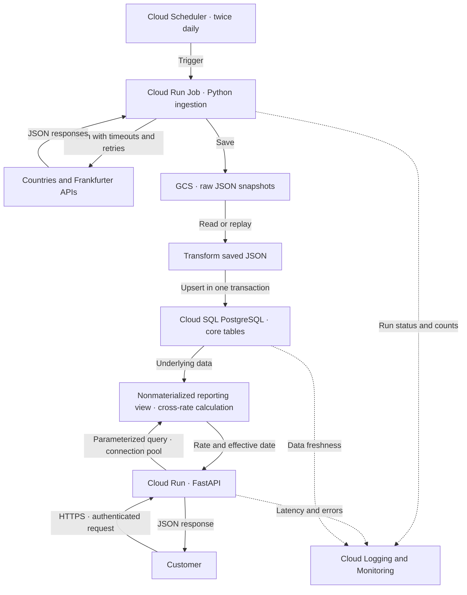

# Part 2: Production Design

[Project overview](README.md) · [Part 1 implementation](part1.md)

**Production Architecture:**

Now, what are we doing here? 

We are setting up the architecture to power a customer-facing application that allows users to check exchange rates between two countries, based on ISO codes they provide. 

In a nutshell, I would build this system on GCP by separating daily ingestion/transformation from the customer-facing API.

Let's dive into the fun details, shall we!

## Architecture diagram

## How would I build this system?

### 1. Daily Ingestion: 

**Cloud Scheduler** would trigger a **Cloud Run** Job twice daily to run the containerized Python ingestion pipeline:

1. **Fetch** data from APIs 
2. **Save** the raw responses in a **GCS bucket**. This is the SSOT so the database can always be rebuilt from here, without necesssarily calling the API again.
3. **Transform** the raw JSON into records matching the structure of the core.* country and exchange-rate tables - adapting the pipeline we made in Part1.
4. **Load** prepared data into the core.* tables in **PostgreSQL on Cloud SQL**. We'll use upserts against defined unique keys so re-running a job updates existing records rather than creating duplicates.

**Additional notes/design choices/trade-offs:**
1. The Frankfurter API collects information from many banks that publish their data on different schedules - calling the API twice ensures we capture any change/update. 
2. The reporting model is a non-materialized view which requires no refresh in the daily ingestion. 
3. Atomic publication: We'll publish prepared database changes in a single transaction so if loading fails, we roll back the changes so the customer-facing API doesn't see partially updated data.
* Cloud Run instead of Cloud Composer: This is a small, sequential workflow which can easily be handled by Cloud Scheduler + Run. This helps us avoid the cost and operational overhead of maintaining the Cloud Composer environment. We can consider the latter if and when the workflow grows and requires many complex dependencies. 

## 2. Database
Use **Cloud SQL with PostgreSQL** to store the country and exchange-rate tables, as well as the reporting views. 

The customer facing API will need to resolve country codes to currency codes, and then retrieve the corresponding exchange rate for specific dates. PostgreSQL is well-suited for these small, targeted queries while Cloud SQL provides the managed database hosting. 

Things the database would include: 
1. 4 normalized tables + 1 nonmaterialized reporting view  
2. Indexes supporting country code lookups and exchange-rate lookups by currency and dates. 
3. Unique constraints matching each table's grain, supporting idempotent upsert ingestion 

**Design choices/trade-offs:**
1. Use of a logical join instead of FKs to prevent rejection and pipeline interruption in case of an orphaned code - which is then retained in the core tables but the inner join excludes them for reporting.
2. Non-materialized reporting view: It's a lot of data (days since 2026-01-01 * all possible combinations of currency pairs) and so, it's better to calculate on demand.  This also saves us a separate refresh during ingestion. We can consider materialization if measured query performance justified it.
3. CloudSQL vs BigQuery: We're looking at a relatively small dataset for an API that primarily requires fast, predictable lookups (by currency codes and dates) as opposed to complex, historical analytical processing.

*Note: I see potential for increased analytical processing e.g. with joins to customer transactions in the future, at which point we can introduce BQ as a separate analytical layer.*

## 3. Serving the Customer facing API:
A **Python FastAPI application** deployed on **Cloud Run**, exposing a REST endpoint, accepting 2 ISO country codes and (optionally) dates (If no date is given, we'll default to the latest available date that rate is available for.)

The service would:
1. Validate inputs (Check the country code format and date format; reject future dates) 
2. Resolve currencies: Use the country codes to find associated currencies (in our PostgreSQL database) 
3. Query the reporting view using a parameterized SQL query for the currency pair and given date, retrieving the cross-currency rate calculation from the view. These inputs should be bound parameters, instead of concatenated SQL strings.

What would the response look like:
A JSON response would include the country code pair, currency pair, calculated rate, and requested date, date of exchange rate.
FYI the exchange rate is unit of target currency per 1 unit of source currency.

**Design choices/trade-offs:**
1. The emphasis on (requested date vs date of exchange rate) in the JSON response is because we might not have the record for a specific date (holidays, pipeline didn't run etc) and it's better to clarify what's being given.
2. The default for date (if not provided by the user) is latest common effective date between the country/currency pairs on or before the requested date.
3. What about countries that have multiple currencies? I'd talk with the Product to see what they're looking for but possible solutions:
    1. Allow data for the multiple currencies to show up in response 
    2. Allow users to specify currency code in the payload as well 
    3. Curate a specific table that selects a 'default' currency and send only that response

My recommendation: Accept optional source/target currency codes and *require* an explicit selection when a country has multiple currencies. This helps get the customer what they're looking for, and avoiding silently choosing a default for them. 

Other errors to keep in mind:

| Condition | Response |
| --- | --- |
Unknown country code | 404 `unknown country` |
Currency not published (no rates exist) | 404 `rate_unavailable`
Invalid input format (either country/currency code or date) | 422 `invalid inputs` |
Same currency on both sides | 200 rate = 1 |
Database error | 503 with request ID |
Unexpected application error | 500 internal error with request ID |

### 3.1. Connections: 
1. The API would reuse a small connection pool per Cloud Run instance rather than opening a new database connection for every request.
2. Set the per-instance pool small (for example 5 connections with no overflow) and cap Cloud Run max-instances so that API's total connection usage is within the database's connection budget (keeping in mind capacity for ingestion and admin)
3. Keep min-instances: 1 on the API to avoid cold-start latency - although additional instances may still have that issue. 

### 3.2: Caching:
This is more of a future improvement but needs to be kept in mind, if production shows a need for it. 

In that case, I would cache successful API responses using source/target country codes, resolved currency codes and requested/latest date as the cache key. 

1. Expiration: A short, configurable TTL to limit how long cached responses can remain stale
2. Placement: A small, bounded in-memory cache per Cloud Run instance should be sufficient initially. If need grows, we can consider Redis. 

## 4. Security and monitoring: 

1. API access: Serve requests over HTTPS through GCP API Gateway, validating customer JWTs for authentication and enforcing per-client request quotas.  
2. Least privilege / separation of concerns: Use separate SAs and PostgreSQL roles for ingestion and serving. For the former, the ingestion job needs to be able to save the raw responses in GCS and write them into the PostgreSQL tables, whereas for the latter, you only need read-only database access to reporting mart.
3. Ingestion: Log each run's ID, status, duration, record counts and alert on failed runs. 
4. Monitor latest available rate separately to investigate non-publication days, failed runs etc.
5. API Health: Monitor latency, error rates etc. Include request IDs in logs and error responses for easier debugging.troubleshooting down the line. 
6. For best results, I'd champion using IaC for easier maintainence, version control, reproducability and review.
7. Availability: I'd use regional Cloud SQL high availability for automatic failover across zones. Cross region recovery would be a future improvement.

## 5. Failure Handling and Recovery: 

What's a robust proposal if you don't plan for things to go wrong? 

Ingestion:
1. Source API Failures: Set request timeouts, (bounded) retries with exponential backoffs + jitters and that honor retry-after. Fail when retries are exhausted. 
2. Failed ingestion: Keep the last successful published database state. We've built such protections thoughout this plan; database changes are committed together in a single transaction, and failed writes are rolled back so customers never see a partially loaded update.
3. Reprocessing/idempotency: Allow reprocessing from saved GCS data after fixing a failure - upserts against unique keys make repeated loads of same records safe

Customer facing API failures:
1. Set database query timeouts so requests don't hang indefinitely. 
2. Monitor server-error rates and alert on failures. 
3. Return 503/500 error codes where appropriate, with request IDs for trouble shooting.

## 6. Cost estimation: 

* We'll start with a small Cloud SQL instance and cap Cloud Run instances to control costs. 
* Keeping one API instance warm will reduce cold-start latency, but add costs. 
* Regional Cloud SQL HA also increases sost in exchange for automatic failover. 
* On the other hand, we can apply a GCS lifecycle policy to limit raw data retention costs and set up billing alerts to keep abreast of costs.

I explored the proposed setup in the [Google Cloud Pricing Calculator](https://cloud.google.com/products/calculator?utm_source=chatgpt.com&hl=en&dl=CjhDaVEzTnpCa05qTm1ZaTAwTkRBNUxUUmlPV1V0T1RNMk55MDNaR0ZpTnpJM09EYzNNamtRQVE9PRAHGiRBQ0M4NTQxMi0wNkU0LTRGQzktQjg5Ny02NEEyMzA3Q0I4RUU) and estimated approximately $110 per month, based on the configuration I selected. 

*Actual costs would of course depend on traffic, database sizing, storage, and availability settings.* 

